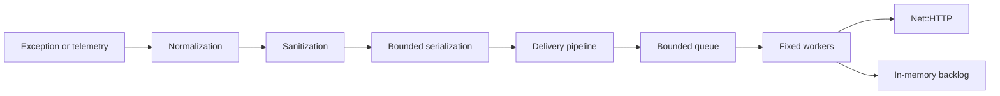

# Chronos Ruby

Chronos Ruby 1.2.2 sends exceptions, metrics, and bounded telemetry from Ruby and Rails applications to Chronos. This is the transitional line for Ruby >= 2.7 and < 3.5, using protocol v1. Release preparation does not imply publication or promotion of unverified framework combinations.

## What the gem collects

The transitional line can collect:

- exception class, message, structured backtrace, and chained causes;
- timestamp, severity, tags, and an optional fingerprint;
- context, parameters, session, and user information supplied by the application;
- Ruby version, engine, platform, PID, opaque thread identifier, and hostname;
- environment, service, application version, release, revision, deploy ID, region, and instance;
- Rack/Rails request method, normalized route, status, duration, and timing breakdown;
- normalized SQL without literals or bind values, plus heuristic performance signals;
- Sidekiq/Active Job activity, cache operations, explicitly instrumented outbound HTTP, and loaded dependencies;
- bounded breadcrumbs supplied by the application or integrations.

See the full inventory in [Collected data](docs/data-collected.md).

## What is not collected by default

The agent does not scan environment variables, the filesystem, or lockfiles. It does not collect HTTP bodies, cookies, authorization headers, email contents, raw SQL, bind values, cache values, or source code. Query plan inspection is disabled by default; when enabled, it uses the original SQL only on the local connection for `EXPLAIN` without `ANALYZE`, then discards it. Dependency inventory includes only names and versions of loaded dependencies, once per agent. The application remains responsible for data minimization and the legal basis for sending data.

The explicit deploy CLI described below reads its documented environment variables and optional configuration file. It does not change how the Ruby configuration API works.

## Supported Ruby and framework versions

The core matrix covers MRI 2.7, 3.0, 3.1, 3.2, 3.3 and 3.4. Rails 7.0/7.1 and Sidekiq 7 require Ruby 2.7 or newer; Rails 7.2 requires Ruby 3.1 or newer. The exact application smoke pairs and their evidence are documented in [Compatibility](docs/compatibility.md). They remain Best effort until all mandatory promotion gates pass. Rails 8 and Ruby 4 belong to the separate 2.x plan.

The transitional integrations include fiber-aware context, Rails Error Reporter, Action Cable, Faraday, optional W3C Trace Context, automatic Rails/Sidekiq installation, and coexistence with an application-managed OpenTelemetry SDK. These integrations are preserved by this deploy CLI port.

Legacy Ruby 2.2–2.6 and Rails 4/5 consumers must use an appropriate 1.1 release. Technical compatibility does not provide security maintenance for end-of-life runtimes or frameworks.

## Installing in plain Ruby

Add the stable version to your `Gemfile`:

```ruby
gem "chronos-ruby", "~> 1.2.2"
```

Use Bundler 2 on a compatible runtime (CI pins 2.4.22):

```bash
gem install bundler -v 2.4.22
bundle install
```

Without Bundler:

```bash
gem install chronos-ruby -v 1.2.2
```

## Installing in Rails

Load the Rails integration explicitly to keep Rails/ActiveSupport out of plain Ruby applications:

```ruby
gem "chronos-ruby", "~> 1.2.2", :require => "chronos/rails"
```

Generate the initializer:

```bash
rails generate chronos:install
```

Version 0.5 introduced the Railtie, middleware, and idempotent subscribers through public APIs and feature detection. Automatic collection is disabled in tests and the console by default. See [Legacy Rails](docs/modules/rails-legacy.md).

## Minimal configuration

An enabled agent requires `project_id` and `project_key`. The default `host` is `https://chronosmonitor.com.br`. Set the environment and service explicitly whenever possible.

```ruby
require "chronos"

Chronos.configure do |config|
  config.project_id = ENV["CHRONOS_PROJECT_ID"]
  config.project_key = ENV["CHRONOS_PROJECT_KEY"]
  config.host = "https://chronosmonitor.com.br"
  config.environment = ENV["APP_ENV"] || "production"
  config.service_name = "billing"
  config.app_version = ENV["APP_VERSION"]
end
```

TLS verification is enabled by default. The Ruby API requires an explicit `ssl_verify = false` to use HTTP, which should be restricted to local test endpoints. After configuration, verify credentials and ingestion:

```bash
bundle exec rake chronos:verify_integration
```

The task sends an identified synthetic exception and returns exit code `0` only after a correlated v1 response. In plain Ruby, register the task with `require "chronos/rake_tasks"` and `Chronos::RakeTasks.install`; from Ruby code, use `Chronos.verify_integration`. See [Integration verification](docs/modules/integration-verification.md).

## Automatic capture

For Rack applications, optionally install the middleware. It reports unhandled exceptions, preserves the original exception for the application, and does not consume request bodies.

```ruby
use Chronos::Integrations::Rack::Middleware,
    :include_user_agent => false
```

In Rails, the Railtie installs middleware and subscribers once. See [Request monitoring](docs/modules/request-monitoring.md).

## Manual capture

Use asynchronous capture in application flows:

```ruby
begin
  perform_payment
rescue StandardError => error
  Chronos.notify(error, :tags => ["payment"])
  raise
end
```

Synchronous capture is available for scripts and controlled shutdown:

```ruby
delivered = Chronos.notify_sync(RuntimeError.new("import failed"))
```

Internal capture failures return `false` without escaping into the application's main flow.

## User context

User context is opt-in. Send only necessary, authorized fields:

```ruby
Chronos.notify(error, :user => {"id" => "customer-42", "role" => "operator"})
```

Values are bounded and sanitized, but data minimization remains the application's responsibility. See [Execution context](docs/modules/context.md).

## Breadcrumbs

Breadcrumbs use a bounded ring buffer in the current scope:

```ruby
Chronos.add_breadcrumb(
  :category => "custom",
  :message => "payment started",
  :metadata => {"provider" => "example"}
)
```

The gem does not turn logs, SQL, or bodies into raw breadcrumbs. See [Breadcrumbs](docs/modules/breadcrumbs.md).

## Filters and LGPD

The gem blocks sensitive keys and detects Bearer tokens, JWTs, email addresses, Brazilian CPF/CNPJ identifiers, and valid payment card candidates. IPv4 addresses are anonymized by default. You can extend the blocklist, apply irreversible hashing, or add custom filters:

```ruby
Chronos.configure do |config|
  config.blocklist_keys += [:medical_record, /bank_account/i]
  config.hash_keys += [:customer_id]
  config.filters << proc { |key, value| key.to_s == "internal_reference" ? "[REMOVED]" : value }
end
```

Diagnostic trees are copied with cycle, depth, collection, node, and string limits before immutable event construction. Caller-owned telemetry data is not frozen. Sensitive symbol values are filtered before conversion to JSON text. Sanitization happens before queueing, retries, and backlog storage. See [Privacy and LGPD](docs/privacy-lgpd.md).

## Ignore rules

Configuration can exclude entire environments. Version `0.9.0.pre.2` introduced bounded local rules, preserved in the stable API:

```ruby
Chronos.ignore_if do |notice|
  notice.exception_class == "SomeExpectedError"
end
```

Rules receive a normalized, immutable notice. Only `true` discards it, and callback failures are contained. See [Ignore rules](docs/modules/ignore-rules.md).

## Performance monitoring

Version 0.7 introduced local request, query, and job aggregation into `metric_batch`; Version 0.8 added outbound HTTP. Groups contain bounded counts, errors, durations, histograms, approximate percentiles, severities, diagnostics, statuses, and timing breakdowns.

```ruby
Chronos.configure do |config|
  config.apm_enabled = true
  config.apm_max_groups = 200
  config.apm_flush_count = 100
  config.apm_batch_size = 50
  config.apm_max_queries_per_request = 100
  config.apm_slow_query_threshold_ms = 500.0
  config.apm_n_plus_one_threshold = 5
  config.apm_trace_ttl_seconds = 60.0
  config.apm_query_analysis_enabled = true
  config.apm_query_analysis_max_queries = 100

  # Opt-in: each eligible fingerprint may inspect catalogs, statistics, or plans.
  config.apm_query_inspection_enabled = false
  config.apm_query_statistics_enabled = false
  config.apm_query_plan_enabled = false
  config.apm_query_inspection_min_duration_ms = 500.0
  config.apm_query_inspection_max_queries = 20
  config.apm_transaction_tracking_enabled = true
  config.apm_transaction_max_connections = 100
end
```

By default, the analysis pipeline does not read raw SQL or bind values. Opt-in inspection uses the original SQL only locally to request `EXPLAIN` without `ANALYZE`; it never includes that SQL in the event. Oversized, incomplete, or lexically ambiguous SQL is omitted instead of emitting partial literals. Plan inspection validates the entire original query and rejects multiple statements independently of normalized metadata. Static analysis produces candidates rather than instructions to create indexes. Errors use `error` severity; slowness and risks use `warning`; observed patterns use `info`; proposed fixes use `suggestion`. See [APM](docs/modules/apm-aggregation.md), [Requests](docs/modules/request-monitoring.md), and [SQL](docs/modules/sql-monitoring.md).

## Sidekiq and Active Job

The Rails integration detects Sidekiq and installs its client/server middleware automatically. Explicit loading remains available in plain Ruby applications. Historical middleware support began with `0.6.0.pre.1`; Sidekiq 4/5 users must remain on a matching legacy release.

```ruby
gem "sidekiq", "~> 7.3"
gem "chronos-ruby", "~> 1.2.2", :require => "chronos/rails"
```

Without Rails, load `chronos/sidekiq` after Sidekiq. The context envelope preserves public arguments and contains only bounded trace/span/request IDs and flags. Active Job uses its namespaced `chronos_context` field and public serialization hooks. Nested errors are deduplicated and re-raised. See [Sidekiq](docs/modules/sidekiq-legacy.md), [Active Job](docs/modules/active-job.md), and [Jobs](docs/modules/job-monitoring.md).

## Deploy tracking

Version 0.9 introduced synchronous deploy reporting and fixed correlation across events:

```ruby
Chronos.notify_deploy(
  :environment => "production",
  :revision => ENV["GIT_SHA"],
  :version => ENV["APP_VERSION"],
  :repository => "owner/repository",
  :actor => ENV["DEPLOY_USER"]
)
```

Configure release/revision/deploy metadata when each new process starts. The Ruby API does not read Git or environment variables automatically. Capistrano is optional; Kamal and GitHub Actions recipes are available in `examples/deploy/`. See [Deploys](docs/modules/deploys.md).

Version 1.2.2 ports a packaged deploy command without a copied Ruby notification script:

```bash
bundle exec chronos deploy notify
```

Supply `CHRONOS_PROJECT_ID`, `CHRONOS_PROJECT_KEY`, `CHRONOS_ENVIRONMENT`, a stable `CHRONOS_DEPLOY_ID`, and `CHRONOS_DEPLOY_REVISION` or `CHRONOS_DEPLOY_VERSION` for the artifact actually published. The CLI reads explicit ENV and optional public YAML without booting Rails. It requires HTTPS and never accepts the project key as a process argument. Optional integration installers cover Kamal, Capistrano, GitHub Actions, GitLab CI, Jenkins, and Azure DevOps. Integration file installation requires POSIX filesystem support (Linux/macOS) and anchors operations to opened directories to prevent symlink redirection.

This branch prepares 1.2.2; publication remains subject to the [release gates](docs/release-1.2.2-readiness.md). See the [CLI guide](docs/deploy-cli.md) for configuration, receipt verification, exit codes, and integration fragments.

## Asynchronous queue

The queue has a fixed capacity, drops the newest event when full, and starts workers only after the first accepted capture.



Use `Chronos.flush(timeout)` before termination and `Chronos.close(timeout)` during shutdown. Workers are recreated after a fork. See [Asynchronous queue](docs/modules/async-queue.md).

## Retry and backlog

Retries cover network errors and HTTP `408`, `429`, and `5xx`, with exponential backoff, jitter, and bounded attempts. Other `4xx` responses are permanent failures. A circuit breaker reduces retry storms.

The backlog stores only sanitized, serialized events. It has a fixed capacity, lives in memory, and is lost on shutdown. Remote configuration accepts only sampling, enabled event types, a smaller payload limit, exact fingerprints, send interval, and a kill switch; it never changes the host, credentials, or TLS settings, or executes code. See [Retry and backlog](docs/modules/retry-backlog.md), [Sampling](docs/modules/sampling.md), and [Remote configuration](docs/modules/remote-configuration.md).

## Environment-based configuration

The Ruby API does not scan the environment. Read only variables chosen by your application:

```ruby
Chronos.configure do |config|
  config.project_id = ENV["CHRONOS_PROJECT_ID"]
  config.project_key = ENV["CHRONOS_PROJECT_KEY"]
  config.host = ENV["CHRONOS_HOST"]
  config.environment = ENV["APP_ENV"] || "production"
  config.enabled = ENV["CHRONOS_ENABLED"] != "false"
  config.queue_size = 100
  config.workers = 1
  config.max_retries = 3
  config.backlog_size = 100
  config.remote_configuration = true
  config.apm_enabled = true
  config.external_http_enabled = false
  config.cache_key_mode = :none
  config.dependency_reporting = true
  config.app_version = ENV["APP_VERSION"]
  config.revision = ENV["GIT_SHA"]
  config.deploy_id = ENV["DEPLOY_ID"]
end
```

See [Configuration](docs/configuration.md) for all options, defaults, and limits.

## Troubleshooting

Configuration errors are raised during `Chronos.configure`; capture and delivery failures are contained and may be reported to the safe logger. Check TLS, credentials, timeouts, and the return value of `flush`. See [Troubleshooting](docs/troubleshooting.md).

## Benchmarks

The stable release gate runs a repeatable Rack comparison and load against a fake endpoint:

```bash
ITERATIONS=50000 WARMUP=5000 SAMPLES=7 bundle _2.4.22_ exec ruby benchmarks/comparative.rb
ITERATIONS=500 bundle _2.4.22_ exec ruby benchmarks/fake_endpoint_load.rb
```

Results depend on the runtime and hardware. There is no general claim of superiority: record CPU, OS, Ruby, commit, warmup, samples, median, and dispersion. Additional benchmarks are in `benchmarks/` and documented in [Performance](docs/performance.md).

## Migrating from Airbrake

Migrate in stages. Run both agents together only during validation to avoid prolonged duplicate reporting. Callbacks and notices are not API-compatible and must be translated and tested explicitly. See the [Airbrake migration guide](docs/migration-from-airbrake.md).

## Local development

On a compatible Ruby, install Bundler 2.4.22 and run `bundle _2.4.22_ install`. Use `bin/console` for inspection. See [Architecture](docs/architecture.md).

## Tests

The transitional CI entry point runs RSpec/security regressions, RuboCop 1.57, standalone CLI/adapters, documentation and built-gem smoke tests:

```bash
sh script/ci_transitional
```

For a focused suite/lint check with dependencies installed, use `bundle _2.4.22_ exec rake`. The additional tests and installed-package gates are required before release as well.

### Prepare Docker

Start Docker Desktop on macOS and verify both client and server:

```bash
open -a Docker
docker version
docker info
```

The helper uses Linux/amd64 (emulated on Apple Silicon), mounts the repository read-only, and runs a temporary copy without local Bundler configuration, credentials directories, `.env` files or lockfiles. Host gems and lockfiles are unchanged. Images and dependencies require registry access; no SaaS credentials are needed.

### Run individual core or framework checks

```bash
sh script/test_transitional_docker 2.7
sh script/test_transitional_docker 3.4
sh script/test_transitional_docker 2.7 examples/rails-7.0
sh script/test_transitional_docker 3.2 examples/rails-7.1
sh script/test_transitional_docker 3.4 examples/rails-7.2
sh script/test_transitional_docker 3.4 examples/sidekiq-7
```

Core checks accept Ruby 2.7, 3.0, 3.1, 3.2, 3.3 and 3.4. Rails fixtures pin 7.0.10, 7.1.6 and 7.2.4; Sidekiq pins 7.3.10. The Rails application checks controller/SQL telemetry, Active Job, Error Reporter deduplication, initialization and deploy generation. Sidekiq checks its real middleware chains without starting Redis or a worker process.

### Run the complete configured matrix

This block stops at the first failure and returns a nonzero status:

```bash
(
  set -e
  for version in 2.7 3.0 3.1 3.2 3.3 3.4; do
    sh script/test_transitional_docker "$version"
    sh script/test_transitional_docker "$version" examples/sidekiq-7
  done
  for version in 2.7 3.0; do
    sh script/test_transitional_docker "$version" examples/rails-7.0
  done
  for version in 2.7 3.1 3.2; do
    sh script/test_transitional_docker "$version" examples/rails-7.1
  done
  for version in 3.1 3.3 3.4; do
    sh script/test_transitional_docker "$version" examples/rails-7.2
  done
)
```

Keep per-runtime logs and resolved versions. A stopped matrix does not approve unexecuted combinations. These checks do not replace dependency audit, benchmarks/load, Redis-backed worker lifecycle, authorized provider execution or SaaS receipt/ledger/projection gates. See [1.2.2 readiness](docs/release-1.2.2-readiness.md). Legacy Docker helpers remain historical tools and do not validate this gem's Ruby requirement.

## Contributing

Open an issue before adding a public API or dependency. Public classes require YARD documentation, tests, module documentation, and compatibility evidence. See [CONTRIBUTING.md](CONTRIBUTING.md).

## Security

Never include credentials in context. Releases use Trusted Publishing, SHA-256 checksums, and an SBOM; dependencies are audited. Report vulnerabilities through the private channel in [SECURITY.md](SECURITY.md).

## License

Chronos Ruby is distributed under the MIT license. See [LICENSE.txt](LICENSE.txt).
